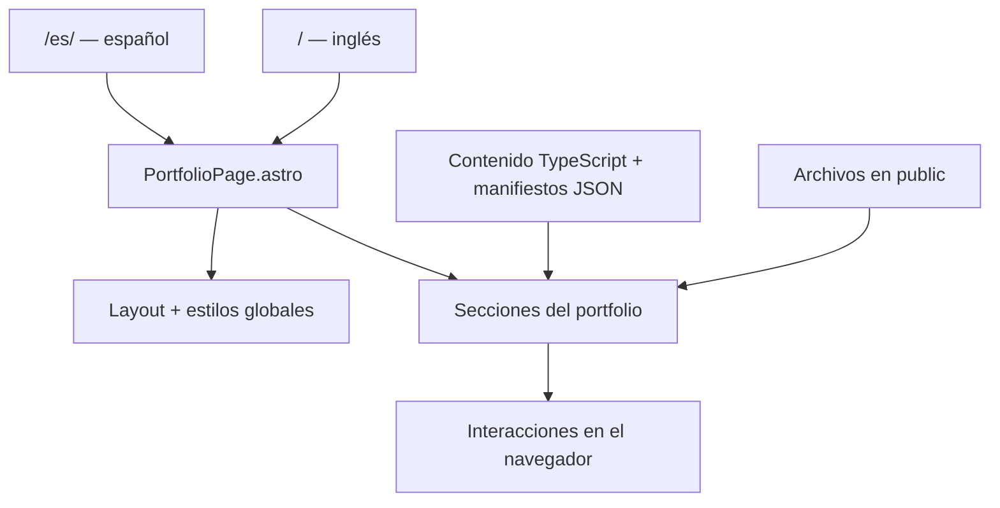

# Guía del portfolio

Documentación del estado actual del proyecto, actualizada el 10 de octubre de 2026. Explica qué hace cada elemento, cómo está construido y dónde modificarlo.

## 1. Arquitectura general

El portfolio está construido con Astro y TypeScript, HTML y CSS. No utiliza React para sus componentes de interfaz. Astro genera dos páginas estáticas; el JavaScript del navegador aporta las interacciones. No hay backend, autenticación ni base de datos del portfolio.

| Archivo | Función |
| --- | --- |
| `src/pages/index.astro` | Página en inglés: `/` |
| `src/pages/es/index.astro` | Página en español: `/es/` |
| `src/components/PortfolioPage.astro` | Ensambla todos los apartados y recibe `lang` |
| `src/layouts/Layout.astro` | Documento HTML, idioma, título, descripción, favicon y enlace para saltar al contenido |
| `src/styles/global.css` | Diseño compartido, variables y ajustes globales |
| `src/content/` | Textos, proyectos, tecnologías y aficiones |
| `src/data/` | Experiencia y manifiestos de imágenes, logos y capturas |
| `public/` | Archivos publicados directamente: imágenes, capturas y PDF |
| `scripts/` | Obtención de recursos y comprobaciones con navegador |



En un componente `.astro`, el bloque entre `---` prepara los datos durante la generación de la página. El HTML define el contenido; `<style>` contiene normalmente estilos limitados a ese componente, y `<script>` añade comportamiento en el navegador. Varios componentes registran un elemento HTML propio, como `<skills-console>`, con `customElements.define()`.

## 2. Orden y navegación

El orden visible se define en `PortfolioPage.astro`: portada → proceso de trabajo → experiencia → proyectos → perfil híbrido y tecnologías → aficiones → invitación de contacto → pie. La bienvenida se superpone al principio y el contacto flota sobre la página.

| Apartado | Identificador HTML | Componente |
| --- | --- | --- |
| Portada | `profile` | `Hero.astro` |
| Proceso de trabajo | `profile-details` | `Profile.astro` |
| Experiencia | `experience` | `Experience.astro` |
| Proyectos | `projects` | `Projects.astro` → `ProjectGallery.astro` |
| Perfil híbrido | `skills` | `Skills.astro` → `TechnologyCatalogue.astro` |
| Aficiones | `hobbies` | `Hobbies.astro` |
| Invitación final | `start-project` | `ProjectCTA.astro` |
| Botones flotantes | `contact` | `FloatingContact.astro` |

`Sidebar.astro` contiene el menú, selector de idioma y estado visual del sistema. Los enlaces utilizan anclas como `#projects`; un script actualiza la sección activa al desplazarse. En móvil cambia su disposición. El estado «online» es una etiqueta de diseño, no un monitor de disponibilidad del servidor.

`BrandMark.astro` inserta el SVG de `public/images/brand/monogram.svg`: una M, símbolos de código y un círculo. El favicon tiene su propio archivo `public/favicon.svg`; si se modifica la identidad deben actualizarse ambos. El logo no contiene las animaciones del reactor.

## 3. Bienvenida de JARVIS

**Archivos:** `JarvisBoot.astro` y `ArcReactor.astro`.

La bienvenida utiliza un `<dialog>` modal a pantalla completa. Muestra el reactor, mensajes por etapas y una barra `<progress>`. Un temporizador actualiza el porcentaje cada 80 ms; llega al 100 % aproximadamente a los 2,6 segundos y cierra la ventana a los 3,1 segundos.

El porcentaje representa una secuencia visual programada: no mide la descarga de imágenes ni espera a que todos los recursos estén cargados. Aparece en cada recarga, se puede saltar con el botón o Escape y se omite cuando el sistema solicita reducir el movimiento. Sin JavaScript no abre el diálogo.

Para cambiar mensajes, editar `messages` en este componente. Para cambiar duración, revisar el cálculo `elapsed / 26` y el cierre a `3100` conjuntamente.

## 4. Portada y reactor

**Archivo:** `Hero.astro`. **Textos:** `src/content/es.ts` y `en.ts`, además de etiquetas locales del componente.

La portada combina presentación, descripción, descarga del CV, asistente, reactor e indicación para seguir explorando. El encabezado técnico muestra «Interfaz: Porfolio» en español. El enlace de descarga utiliza `/documents/CV-Manuel-Munoz-Cobos.pdf`.

El reactor no es un vídeo ni una imagen: `ArcReactor.astro` superpone cinco círculos HTML con bordes, degradados y sombras. Su órbita gira durante 24 segundos y los segmentos durante 40 segundos en sentido inverso. La versión `compact` se utiliza en la bienvenida. Su paleta cian y dorada es independiente de la paleta principal.

El botón que envuelve el reactor activa una tarea del protocolo secreto. Para cambiar su aspecto, editar `ArcReactor.astro`; para tamaño, distribución o espacio inferior de la portada, editar `.hero` y `.hero-visual` en `Hero.astro`. La portada tiene actualmente un espacio inferior adaptable de 160 a 220 px y, en escritorio, una altura mínima de `100svh + 80px`.

## 5. Preguntar a JARVIS

**Archivo:** `JarvisAssistant.astro`.

El asistente tiene accesos rápidos y un formulario. Al enviar una pregunta, normaliza el texto —minúsculas y eliminación de tildes— y busca palabras relacionadas con tecnologías, administración, datos, experiencia, proyectos, contacto o perfil. Selecciona una respuesta predefinida y actualiza una zona `aria-live`.

Funciona después de desplegar una web estática: no necesita clave, cuenta ni API. Las preguntas no se envían a un servicio externo y no se conserva un historial de conversación. No es un modelo de IA y no está conectado a la conversación de desarrollo de este portfolio.

Las respuestas se mantienen en `answers` y `commands`; ampliar el catálogo de tecnologías no actualiza automáticamente esas respuestas. Para convertirlo en un asistente generativo sería necesario crear una integración desde el servidor, proporcionar el contenido del perfil y guardar allí las credenciales.

## 6. Proceso de trabajo

**Archivo:** `Profile.astro`. **Datos:** `content.profile` en `es.ts` y `en.ts`.

El recorrido Conectar → Resolver → Construir presenta la idea, el plan y el producto. El componente reordena `content.approach` para mostrar esas fases. Cada fase tiene una escena realizada con HTML/CSS: mensajes de conversación, capas de arquitectura o una ventana de producto terminado.

Las pestañas y el botón «Siguiente paso» cambian el panel. El cambio combina opacidad, desplazamiento, perspectiva y recorte mediante Web Animations API. Se admiten flechas, Home y End. El cristal y el radio pertenecen al contenedor exterior; las tres pestañas interiores tienen esquinas rectas. Un bloque `<noscript>` permite leer las fases restantes sin JavaScript.

## 7. Experiencia y empresas

**Archivos:** `Experience.astro`, `src/data/experience.ts`, `src/data/employer-logos.json`.

La trayectoria contiene seis puestos del CV, con empresa, fechas, cargo y funciones bilingües. Se representa como una línea temporal, con dos columnas escalonadas en pantallas amplias. Cada puesto usa un panel casi opaco sobre el fondo ambiental de laboratorio.

Las funciones se despliegan mediante `<details>` y `<summary>`, que funcionan sin JavaScript. Abrirlas registra una tarea del easter egg. El logo y el nombre enlazan a la web corporativa; los logos se sirven desde `public/images/employers/`.

Para añadir un puesto, crear su registro en `experience.ts` y asegurar que su clave `employer` existe en el manifiesto de logos. Las fechas no se actualizan automáticamente desde LinkedIn ni desde el PDF.

## 8. Proyectos, capturas y dispositivos

**Archivos:** `Projects.astro`, `ProjectGallery.astro`, `ProjectMockup.astro`, `src/content/project-gallery.ts`, `src/data/project-captures.json`.

`Projects.astro` delega la presentación en la galería. El catálogo contiene 13 tarjetas y 16 sitios. Córdoba a Pie, Granada Tours, Sevilla a Pie y Málaga a Pie forman una tarjeta conjunta. Cada ciudad conserva su dominio, descripción, destacados y capturas. Granada utiliza `granadatours.com.es` y ARFE `arfe.sieinformatica.net`.

Los filtros muestran turismo, corporativas, comercio electrónico o aplicaciones. El selector de ciudad cambia imágenes, texto, dominio y enlace de la tarjeta. Un `<dialog>` permite ampliar las capturas. Las tarjetas entran al hacer scroll y los dispositivos se inclinan con el puntero; esos efectos se limitan cuando se solicita reducir movimiento.

Los monitores y teléfonos son estructuras HTML/CSS que enmarcan WebP reales de las webs. No son iframes: el contenido mostrado es una captura guardada y no cambia hasta regenerarla. Al pasar el puntero por la pantalla, la captura se desplaza para mostrar más contenido. Si falta una captura, aparece una alternativa y se desactiva su ampliación.

Para añadir un proyecto, editar `project-gallery.ts`. Para obtener su captura mediante el script también hay que añadir su slug y dominio a la lista de `scripts/capture-projects.mjs`. El slug debe coincidir con la clave del manifiesto.

```powershell
node scripts/capture-projects.mjs secrets-of-cordoba
node scripts/capture-projects.mjs lanvert longrock
```

Sin argumentos se revisa la lista completa. El script abre páginas públicas con Edge/Chrome, obtiene metadatos, captura escritorio y móvil y guarda archivos en `public/projects/`. No inicia sesión ni envía formularios. Los resultados deben revisarse porque la web de origen puede cambiar o mostrar errores.

## 9. Perfil híbrido, formación y tecnologías

**Archivos:** `Skills.astro`, `TechnologyCatalogue.astro`, `src/content/interface.ts`, `src/content/technologies.ts`.

El perfil tiene tres áreas: desarrollo, administración y ciencia de datos. Sus títulos y capacidades se encuentran en `interfaceContent.skills.groups`. La formación se define en `Skills.astro`: MEDAC para desarrollo web, Universidad de Córdoba para ADE y UNIR para Visual Analytics y Big Data. El estado del máster refleja el CV de junio de 2026; hay que actualizarlo manualmente si cambia.

Los nodos Código, Datos y API rodean el núcleo. Al seleccionar un área, una pista exterior gira 120 grados; cada etiqueta gira en sentido contrario para seguir siendo legible. Los anillos añaden una vuelta completa y conservan su rotación continua. El centro pulsa y reacciona al puntero. Las pestañas también admiten navegación por teclado. El fondo del laboratorio cambia según el área activa.

El catálogo contiene 18 categorías: lenguajes, Python, PHP, JavaScript, móvil, Java, API, CMS/ERP, SQL, NoSQL, grafos, nube/contenedores, servidores, versionado/despliegue, análisis, modelos, ofimática y desarrollo con IA. Incluye las tecnologías del CV y las confirmadas por el propietario, como Redis, FacturaScripts, Neo4j, Codex y Claude Code.

Los filtros seleccionan grupos completos; una misma herramienta puede aparecer en varias categorías. No representan niveles, puntuaciones ni años de experiencia. Los bloques inferiores describen tareas concretas: plugins y módulos PHP para WordPress y FacturaScripts, modelos Python, cuadros de mando Power BI con esquemas estrella, servidores Linux y automatización de despliegues.

Para añadir una tecnología, modificar `items` de su categoría en `technologies.ts`. Para añadir una categoría, definir `id`, icono, título ES/EN y elementos; incluir su `id` en los filtros correspondientes. `Icon.astro` contiene los iconos disponibles. Los filtros no afectan a los dos bloques descriptivos inferiores.

## 10. Aficiones: fuera del código

**Archivos:** `Hobbies.astro`, `CategoryArtwork.astro`, `src/content/hobbies.ts`, `src/data/hobby-images.json`, `src/data/hobby-sources.json`.

El explorador contiene ocho categorías y 29 elementos: películas/series, anime, viajes, deporte, perros/gatos, videojuegos, música y aficiones —Kawasaki Z125 y Córdoba CF—. Empieza mostrando viajes.

Las categorías utilizan composiciones SVG planas en `CategoryArtwork.astro`. Al seleccionar una, cambian la imagen protagonista y las tarjetas. La transición combina una imagen saliente recortada en diagonal, zoom de la entrante y aparición del título. Hay botones anterior/siguiente, indicadores, flechas de teclado, gestos táctiles y un visor ampliado.

Las imágenes individuales son fotografías reales, carteles o material original, no composiciones generadas. Se sirven localmente en WebP de 900 × 675 px, proporción 4:3. El manifiesto de imágenes registra archivo, dimensiones, fuente y crédito; el de fuentes contiene las URLs originales y recetas de actualización.

Para añadir una afición, crear su elemento en `hobbies.ts`, añadir su fuente y generar el archivo/manifiesto. Los identificadores deben coincidir. Los SVG de categorías se modifican por separado de las fotografías.

```powershell
node scripts/fetch-hobby-images.mjs paris
```

El script necesita `sharp`; actualmente no está declarado como dependencia directa en `package.json`, aunque se utiliza en los scripts de imágenes. En una instalación limpia conviene comprobar su disponibilidad antes de regenerar recursos. El proceso valida resolución, recorta y convierte a WebP. Los detalles de formato están en [hobby-image-standard.md](hobby-image-standard.md).

## 11. Invitación final y contacto flotante

**Archivos:** `ProjectCTA.astro`, `FloatingContact.astro`, `src/content/interface.ts`.

La invitación final es un bloque compacto con avatar circular y bocadillo «Háblame de tu proyecto», traducido al inglés. La fotografía se configura en `contact.profilePhoto` y utiliza el archivo local `public/images/profile/manuel-cutout-v1.png`: la foto facilitada de LinkedIn, editada para eliminar el fondo y mejorar claridad y color. Si la propiedad está vacía, se muestra el monograma del portfolio.

Un `IntersectionObserver` observa el bocadillo y activa la flecha cuando al menos la mitad aparece en pantalla. La flecha queda junto a los botones flotantes: toma sus coordenadas reales y se mueve de izquierda a derecha con CSS. Un `ResizeObserver` y el evento de cambio de tamaño mantienen la alineación. Al salir del bocadillo se oculta; con movimiento reducido permanece estática cuando corresponde mostrarla.

Los botones abren el cliente de correo mediante `mailto:` o el chat de WhatsApp mediante `wa.me`. En móvil muestran solo iconos, con etiquetas accesibles. El número no aparece como texto visible, pero forma parte del enlace público de WhatsApp. LinkedIn está en el pie. El formulario de JARVIS no envía correos.

Para cambiar contacto o fotografía, editar el objeto `contact` en `interface.ts`. Para servir una foto local, guardarla por ejemplo en `public/images/profile/manuel.webp` y poner `/images/profile/manuel.webp` en `profilePhoto`.

## 12. Easter egg y pie

**Archivo:** `EasterEgg.astro`. El pie está en `PortfolioPage.astro`.

El pequeño reactor del pie abre un protocolo con cinco tareas: activar el reactor principal, preguntar al asistente, ampliar un proyecto, abrir funciones de un puesto y explorar una afición. Los componentes emiten `portfolio:quest` con un identificador; `SecretProtocol` escucha el evento y marca cada tarea una sola vez.

El progreso se guarda en `sessionStorage` con la clave `portfolio-quest-v1`. Persiste al recargar y cambiar de idioma dentro de la sesión de la pestaña. No utiliza servidor ni base de datos. Se puede reiniciar. Al completar las cinco tareas abre una recompensa con Iron Man y permite volver a verla.

La imagen está en `public/images/iron-man-reward.webp`. El pie incluye el año calculado al generar la página, autoría, LinkedIn y acceso al protocolo; para actualizar el año de una publicación estática basta reconstruirla.

## 13. Coherencia visual y animaciones

`global.css` centraliza blanco, rojos y azules metalizados, bordes, tipografías y dimensiones. Exo 2 y Montserrat se cargan desde Google Fonts; los rótulos técnicos utilizan fuentes monoespaciadas del sistema. Logos y fotografías conservan sus colores originales.

| Variable | Uso |
| --- | --- |
| `--content-width: 1180px` | Anchura interior máxima común |
| `--section-gutter` | Margen lateral adaptable |
| `--sidebar-width` | Espacio reservado al menú |
| `--floating-inset` | Alineación lateral del contacto flotante |
| `--radius-panel: 12px` | Radio compartido de paneles |
| `--red-metal`, `--blue-metal` | Degradados metálicos |
| `--glass-background`, `--glass-blur` | Fondo y desenfoque compartidos |

La clase `glass-panel` unifica bordes, sombras, radio y cristal. Los estilos globales y reglas específicas pueden modificar el resultado final: no basta cambiar una propiedad aislada de un componente si existe una regla global que la sobrescribe.

Los fondos ambientales se aplican mediante `::before` con opacidad de 0,24. La portada, experiencia y habilidades utilizan imágenes de laboratorio; proceso, proyectos y aficiones no las utilizan. El CTA tiene un fondo liso. Los paneles oscuros mantienen la legibilidad sobre esas imágenes.

`SectionMotion.astro` detecta `[data-motion]` mediante `IntersectionObserver` y añade `in-view` una vez. Admite entrada vertical, izquierda o derecha. La galería de proyectos tiene su propio observador. Sin JavaScript el contenido general no depende de esas clases para ser visible.

## 14. Idiomas, accesibilidad y móvil

Los idiomas son dos rutas que comparten componentes, no una traducción automática. Los textos generales están en `es.ts`/`en.ts`; otros datos usan objetos `{ es, en }` o expresiones dentro del componente. Para modificar una etiqueta hay que revisar ambas variantes. Los nombres propios y tecnologías se conservan.

La interfaz utiliza enlaces y botones nativos, estados `aria-selected`/`aria-pressed`, zonas `aria-live`, pestañas con teclado, diálogos y enlace para saltar al contenido. `prefers-reduced-motion` omite la bienvenida y reduce múltiples animaciones. Esto no sustituye una auditoría completa de accesibilidad.

La adaptación a móvil combina CSS Grid, Flexbox, `clamp()` y media queries. La barra lateral deja de reservar anchura hasta 760 px; otras secciones tienen puntos de corte específicos. Las imágenes mantienen dimensiones declaradas y muchas utilizan `loading="lazy"`.

## 15. Ejecutar, comprobar y publicar

Requisito declarado: Node.js 22.12 o superior. En PowerShell puede utilizarse `npm.cmd` para evitar restricciones de ejecución de scripts.

```powershell
npm.cmd install
npm.cmd run dev -- --background
npm.cmd run astro -- dev status
npm.cmd run astro -- dev logs
npm.cmd run astro -- dev stop
npm.cmd run build
npm.cmd run preview
```

El servidor suele estar en `http://localhost:4321/`. Si ya hay otro activo, consultar su estado y detenerlo antes de arrancar uno nuevo. La generación produce `dist/`, que contiene la web estática y los recursos de `public/`; esa carpeta es el resultado para publicar. El alojamiento debe servir ambas rutas y todos sus archivos.

Las rutas de recursos empiezan en `/`: el proyecto está preparado para la raíz de un dominio. Publicarlo bajo un subdirectorio requiere revisar esas rutas y la configuración de Astro. No hacen falta secretos para la versión actual. El CV de `public/documents/` sí se publica y es descargable; reemplazarlo antes de reconstruir si se desea otra versión.

```powershell
node scripts/verify-details.mjs
node scripts/verify-gallery.mjs
node scripts/verify-interactions.mjs
```

Las comprobaciones con navegador requieren el servidor activo y Edge o Chrome. Revisan bienvenida, galería, idiomas, contacto, puestos, teclado, easter egg y tamaños de pantalla; guardan capturas de revisión en `.astro/`. No cubren automáticamente cada dato nuevo. Los scripts de captura y descarga necesitan acceso a internet; el portfolio publicado utiliza los archivos locales ya obtenidos.

## 16. Mantenimiento rápido

| Quiero cambiar… | Dónde hacerlo |
| --- | --- |
| Orden de secciones | `PortfolioPage.astro` |
| Presentación y proceso | `es.ts`, `en.ts`, `Hero.astro`, `Profile.astro` |
| Respuestas del asistente | `JarvisAssistant.astro` |
| Experiencia | `experience.ts` y manifiesto de logos |
| Formación | `Skills.astro` |
| Tecnologías y filtros | `technologies.ts` |
| Proyectos y dominios | `project-gallery.ts` |
| Capturas de proyectos | `capture-projects.mjs`, `project-captures.json`, `public/projects/` |
| Aficiones e imágenes | `hobbies.ts` y manifiestos de aficiones |
| Email, WhatsApp, LinkedIn y avatar | `interface.ts`, objeto `contact` |
| Bocadillo y flecha | `ProjectCTA.astro` |
| Colores, anchuras y radios | `global.css` |
| Logo y favicon | Ambos SVG de `public/` |
| Descarga del CV | PDF de `public/documents/` |

Hay archivos de la base anterior que no forman parte de la página actual, como `Header.astro`, `Navigation.astro`, `SystemStatus.astro`, `src/data/projects.ts`, `src/data/skills.ts` y `src/content/projects.ts`. El catálogo activo de la galería es `src/content/project-gallery.ts`. Revisar las importaciones antes de modificar un archivo antiguo para evitar cambios sin efecto visible.

La procedencia de recursos se documenta en [visual-assets.md](visual-assets.md); los fondos en [laboratory-prompts.md](laboratory-prompts.md). Como referencia del framework, consultar la [documentación oficial de componentes Astro](https://docs.astro.build/en/basics/astro-components/) y la [guía de estilos](https://docs.astro.build/en/guides/styling/).
